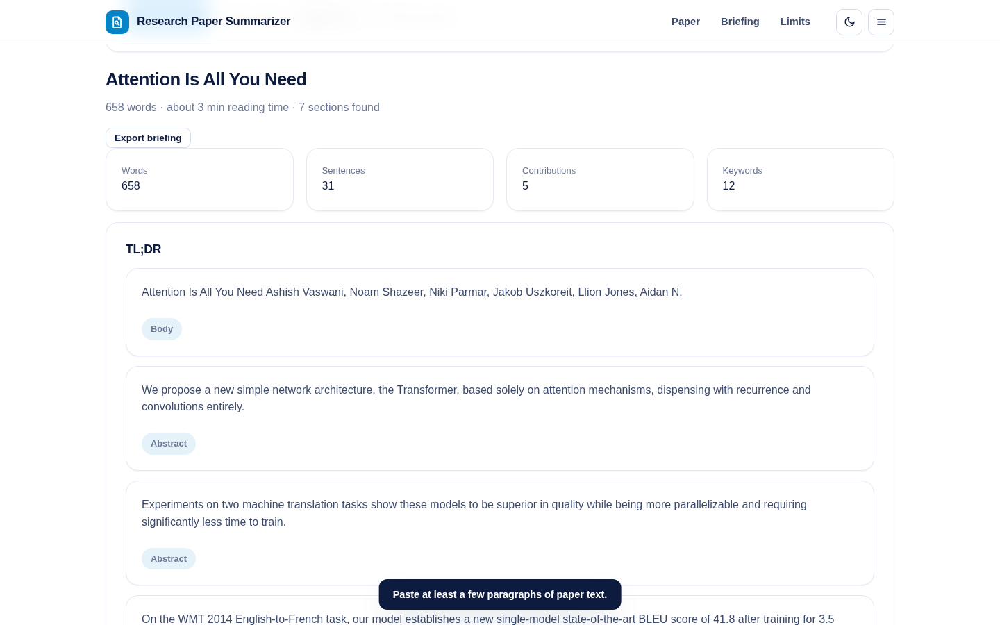
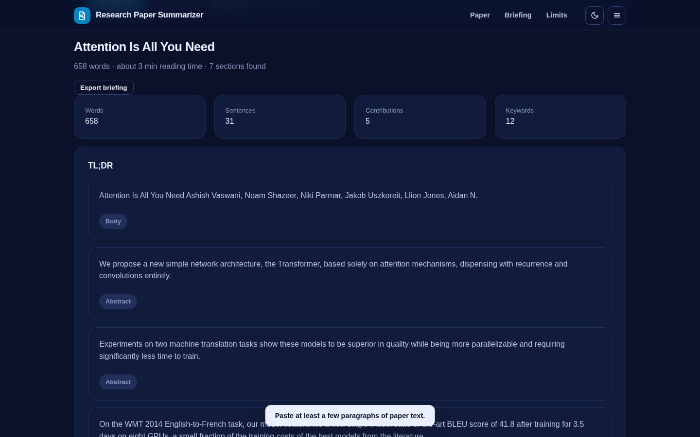
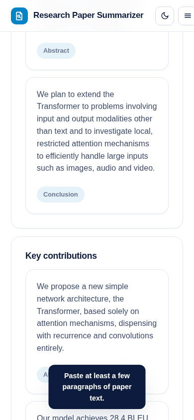

# Research Paper Summarizer

Read a paper in ninety seconds - and verify every line of the briefing against the source.

Paste the text of a research paper and the summarizer finds its sections, scores every sentence, and builds a structured briefing: TL;DR, key contributions, method, results, limitations and keywords. Every sentence is quoted from the paper itself and tagged with the section it came from.

**Live demo:** https://akash991833.github.io/research-paper-summarizer/



## What you get

- **TL;DR** - the highest-value sentences, ordered as they appear, with length control (3, 5 or 8 sentences)
- **Key contributions** - "we propose / present / achieve" sentences
- **Results and numbers** - sentences carrying metrics, percentages and state-of-the-art claims
- **Method** - architecture, dataset and training details
- **Limitations** - caveats and future-work sentences, the section everyone skips
- **Keywords** - top terms by document frequency
- Section detection (abstract, introduction, methods, results, conclusion) and reading-time estimate
- Export the whole briefing as markdown
- Dark and light themes, responsive, installable PWA, works offline

## Honest limits

- Extractive summarization: sentences are selected and ranked, not rewritten. The TL;DR is the paper's own words.
- Works best on papers with standard sections; unusual layouts degrade gracefully to preamble scoring.
- It cannot judge correctness or novelty - read the source sentences before citing anything.
- Plain text input only; copy the text out of the PDF first.

## Tech

Vanilla JS, no build step, no dependencies, no network calls. Sentence scoring uses inverse document frequency with position and section weighting.

## Run locally

```
python3 -m http.server 8061
# open http://localhost:8061
```

## Tests

```
python3 -m http.server 8061 &
node tests/run.mjs
```

56 checks across desktop and mobile, light and dark: title and section parsing, sentence counts, TL;DR length control, contribution/result/limitation extraction, keyword quality, short-input rejection and console cleanliness.



